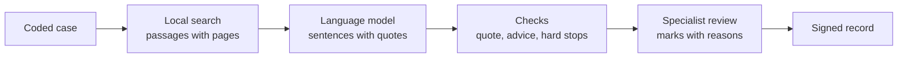

# AI Prosthetic Lab: how the system should work

**Design specification**, drawn from the 31 design pages in this folder (open `index.html`).
Status: a proposal for discussion, October 2026.

This file describes the **target system**. `docs/SYSTEM_DESCRIPTION.md` describes what is built today.
When the two differ, this file says where the build is heading, and `CLAUDE.md` still sets the rules.

---

## 1. Purpose and the one rule

The AI Prosthetic Lab supports the clinical team behind a person who needs a prosthesis or an orthosis:
- prosthetists and orthotists;
- physiotherapists, occupational therapists and rehabilitation physicians;
- the gait lab.

On every screen it puts the person's case next to what the specialist literature says, and the professional decides.

**The system never outputs:**
- a diagnosis;
- a prescription, a dose or a device setting;
- a ranking of components or options;
- whether a person is ready for fitting or discharge;
- a sentence without a quote behind it.

**Every AI sentence:**
- is labelled "AI summary";
- carries a quote from a catalogued source with its page;
- has that quote checked word for word against the source before it is shown. A sentence whose quote fails the check
  is removed.

Grades are shown exactly as the source prints them. Clinical values, rules and thresholds come only from the owner,
the clinic or the specialists, never from the system.

The interface is in **English and Arabic** (right to left). Quotes and citations stay in the language of their source
and are never translated.

## 2. Who uses it

| Role | What they do in the system |
|---|---|
| Prosthetist / orthotist | Assesses the case, writes requirements, chooses components or designs, fits, tunes, follows up, signs |
| Physiotherapist, occupational therapist | Sets rehabilitation goals and doses, records progress, trains with the device |
| Rehabilitation physician | Medical review; receives hard-stop referrals |
| Gait lab | Captures and interprets movement data, reviews indicators |
| Learner / educator | Works teaching cases; the educator sets the answer key (the expert panel's answers) and the case levels |
| Curator | Adds sources, checks their text, curates knowledge items, keeps the Arabic glossary |
| Owner and quality lead | Sets the evidence rules, clinic rules, roles and releases; sees counts, never the records |
| The person | Gives or withdraws consent, receives leaflets and home programmes in Arabic or English, can ask for a copy of their record and its access trail |

## 3. The parts

Four **clinical domains** sit on four **shared parts**:

| Clinical domains | Shared by every domain |
|---|---|
| Prosthetics (use cases 01, 02) | Knowledge layer |
| Orthotics (use case 03) | Reasoning and review |
| Gait analysis (use case 04) | Search and education (use cases 05, 06) |
| Rehabilitation | Patient record and governance (use case 07) |

| Use case | What it does | Part |
|---|---|---|
| 01 | Analyse an amputation case and show the information still needed | Prosthetics |
| 02 | Support component selection from the functional level | Prosthetics |
| 03 | An orthotic case, from analysis to the design workflow | Orthotics |
| 04 | Gait and motion data, measured over time | Gait analysis |
| 05 | Smart search in the specialist library | Search and education |
| 06 | Training and education with applied cases | Search and education |
| 07 | Organising patient data and follow-up | Patient record |

## 4. How one answer is made

Every domain uses the same six-step pathway. Each step has a guard that stops it from overstepping.

| Step | Arabic | Produces | Guard |
|---|---|---|---|
| 01 Case data | بيانات الحالة | Coded fields, each with how it was measured | No identifiers; free text stays in the clinic |
| 02 Information analysis | تحليل المعلومات | What is missing, and the passages each topic finds in the library | Local search only |
| 03 Specialised reasoning | الاستدلال المتخصص | The clinic's domain rules, then a language model summarising the passages | Quote checked word for word |
| 04 Assistive output | توصيات مساعدة | Gaps, options side by side, checks, each with its source | Never ranked, never prescribed |
| 05 Specialist review | مراجعة المختص | Accept, edit or reject each item, with a reason | Nothing acts without it |
| 06 Documented outcome | توثيق النتيجة | The decision, signed, with everything that was shown | Append-only record |

- Only the language-model step leaves the clinic.
- Without the language model the same page still works: it shows the passages without summaries.
- Every answer passes these checks:
  - **Quote check:** the quote is in its passage, word for word. If not, the sentence is removed.
  - **Advice check:** no instruction, dose or setting. If there is one, the sentence is flagged.
  - **Population check:** the source's own population is named and shown.
  - **Hard stops:** the clinic's rules, versioned. A triggered rule routes the case to a person.

## 5. Conventions on every screen

These patterns repeat across the domains. Build them once and reuse them.

- **Header:**
  - the brand and the part's name;
  - the part's modules as numbered tabs;
  - an EN / العربية switch.
- **Case bar:**
  - the case code and a one-line summary;
  - a "Test case · fake data" chip while the system runs on test data;
  - "Decision support: the [prosthetist / orthotist / therapist / team] decides".
- **Measured values:**
  - every value keeps how it was measured (instrument, position, scale);
  - each has a status: *Recorded*, *Not recorded*, *Not asked* or *Recorded as unknown*;
  - mobility and function are measured, never inferred from age or cause.
- **Information needed:** missing items appear before options. Each says why it matters, with a link to the source
  passage.
- **Hard-stop checks:**
  - they are rules set and versioned by the clinic;
  - a triggered check routes the case to the right person (for example a doctor or the diabetic foot team);
  - a check never decides.
- **Requirements before devices:**
  - each requirement is a function ("clear the toes in swing"), never a device;
  - it keeps where it came from (a gait problem, an exam value or a goal);
  - the specialist sets its priority: Must, Should or Nice to have;
  - a requirement that depends on a missing value is marked *provisional*;
  - conflicts between requirements are shown, not hidden;
  - when an exam value changes, the requirements built on it are marked for review.
- **Options side by side, never ranked.** Each option shows:
  - which requirements it addresses (yes, partly or no);
  - what it costs the person;
  - its evidence, with the grade as printed or "practice, no outcome evidence";
  - materials and parts for this case;
  - clinic stock and lead time;
  - what to check at fitting.

  An option that leaves a Must unmet is flagged. The specialist's choice needs a written reason and is recorded with the
  requirements and the evidence shown at the time.
- **Outcome measures:**
  - shown as recorded at each visit;
  - next to "the smallest change that is real", copied from its source with the page;
  - the clinician judges the change, and the system draws no conclusion.
- **Alerts** come from clinic rules (for example "sock ply rising 1 → 5 in six weeks") and link back to the module
  where the fix would happen.
- **Loop back:** follow-up pages link back to re-tune, redesign or re-assess.
- **Patient-facing text** (leaflets, home programmes) is in Arabic and English. The Arabic is checked by an
  Arabic-reading specialist before any patient sees it.
- **Versions:** designs, parameters, alignments, rules and libraries are versioned. Every change keeps who made it and
  why.

## 6. Clinical domains

### 6.1 Prosthetics: from the amputation to follow-up

| Module | Arabic | What it does |
|---|---|---|
| 1 Amputation case assessment | تقييم حالات البتر | Records the case as measured and shows what is still needed |
| 2–3 Requirements and component support | تحليل المتطلبات الوظيفية · دعم اختيار المكونات | Turns the case into requirements, then shows component options side by side |
| 4 Design and fitting decisions | دعم قرارات التصميم والتركيب | Logs every fitting step, observation and adjustment |
| 5 Follow-up and evaluation | المتابعة والتقييم | Tracks outcomes over time and loops back |

**Module 1, assessment.**
- **Residual limb and body,** each with how it was measured: wound, volume over time, length and shape, skin, pain
  (numeric rating), sensation (monofilament), joint range (goniometer), strength (manual muscle test), and the other
  foot.
- **Mobility, measured:** for example a mobility predictor score and a timed walk.
- **Functional level (K-level):**
  - set by the prosthetist;
  - the level's definition is shown in the source's own words with its page;
  - the system never assigns a K-level.
- **Goals by ICF level:** participation, activity and body function.
- **Information needed,** for example cognitive status, the vascular status of the other leg, or the home and work
  setting.
- **Hard-stop checks,** for example an open wound or infection, a still-changing volume, or a neuropathic other foot.

**Modules 2–3, requirements and components.**
- **Requirements table:** ID, "the prosthesis must…", where it came from, and priority.
- **For each component** (foot; socket, liner and suspension), two or three options as in §5, plus:
  - the funding rule as the payer prints it;
  - the maker's weight limit checked against the person's weight.
- **The prosthetist's configuration and reason** are recorded with what was shown. Then the page moves on to design.

**Module 4, design and fitting.**
- **Steps:** shape capture, check socket, bench alignment, static alignment, dynamic alignment, delivery.
- **Observation log for each step:**
  - what was seen, tagged to its gait phase;
  - possible causes, quoted from the manual with its page;
  - the adjustment the prosthetist made;
  - what was seen after.
- **Check-socket versions:** what was seen and what was changed.
- **Before a definitive prosthesis:** the clinic's own checklist, next to what the case recorded and what the guideline
  says. The prosthetist decides when.
- **Alignment record:** values entered by the prosthetist, with every change kept.
- **Fabrication sheet export.**

**Module 5, follow-up.**
- **Visit timeline:** delivery, 2 weeks, 6 weeks, 3 months, definitive fitting.
- **Outcome measures entered at each visit,** for example timed walk, socket comfort score and sock ply.
- **Questionnaires due,** using versions validated in Arabic.
- **Alerts and loop-back links:** refit the socket (module 4), review the components (2–3), re-assess (1).

### 6.2 Orthotics: function first, device second

**The reasoning chain:**
1. impairments and goals;
2. problems by gait phase;
3. what the orthosis must do;
4. design options;
5. fabrication;
6. fit and tune;
7. training with it;
8. follow-up.

Findings loop back to step 3, and the orthotist decides at every step. The domain is built one condition and one
device at a time:
1. stroke AFO;
2. cerebral palsy AFO;
3. diabetic foot footwear and offloading;
4. scoliosis bracing and KAFO after spinal cord injury;
5. digital design.

| Module | Arabic | What it does |
|---|---|---|
| 1 Functional case analysis | تحليل الحالات الوظيفية | Condition module, goals, structured exam, gait by phase, information needed, hard stops |
| 2 Functional requirements | ما يجب أن يؤديه الجهاز | Each problem becomes a requirement, with priority, conflicts and traceability |
| 3 Design options | اختيار وتصميم الأجهزة التقويمية · ربط الحالة بالمكونات والمواد | Two or three configurations side by side, plus referrals |
| 4 Digital design | دعم سير عمل التصميم الرقمي | Scan, rectify, parameters, simulate, manufacture, release |
| 5 Fit, tune and train | ربط الجهاز بالأداء وبالتدريب الوظيفي | Check-out, tuning log, before/after measures, training plan, leaflet |
| 6 Follow-up | المتابعة والتقييم · متابعة تطور الحالة | Outcomes over time, skin and wearing, alerts, loop back |

**Module 1, case analysis.**
- **Condition modules:** stroke, cerebral palsy, spinal cord injury, peripheral nerve injury, diabetic foot,
  scoliosis.
- **Goals by ICF level.** Source notes appear where a guideline speaks to a goal. For example, the stroke guideline
  advises against an AFO or FES when reducing spasticity is the main goal.
- **Structured exam with named scales,** for example the modified Ashworth scale, the MRC muscle test, monofilament
  testing and a 10-metre walk.
- **Gait observed phase by phase:** a checklist from initial contact to swing, observation only.
- **Information needed and hard-stop checks:**
  - ulcer, infection or poor blood supply;
  - a rigid device on insensate skin without pressure relief;
  - fixed contracture beyond what the design can accommodate;
  - FES with an implanted electronic device.

**Module 2, requirements.**
- Each requirement comes from a gait-phase problem, an exam value or a goal.
- Priority is Must, Should or Nice to have.
- Requirements can be provisional.
- Conflicts are spelled out, for example "blocking plantarflexion controls the knee and costs push-off".
- The design knowledge graph (§7.1) links each requirement to the design features that address it.

**Module 3, design options.**
- Requirement chips across the top.
- Two or three option cards as in §5.
- A referral card for treatments outside the orthosis (for example FES, to discuss with the rehabilitation team), with
  its checks.
- The orthotist's choice, with a reason, recorded with what was shown.

**Module 4, digital design.**
- **Steps:** capture, rectify, parameters, simulate, manufacture, release.
- **Views:** side, front, pressure map, compare with the previous version.
- **Simulation results** are labelled "estimate · confirm at fitting".
- **Each parameter** shows where it comes from (a requirement, a practice rule, a scan landmark) and its approval
  state.
- **Version history,** with who made each version and why.
- **Send to manufacture** and the fabrication sheet.
- *Open decision:* the design shows some parameters suggested from scan landmarks. See §11.

**Module 5, fit, tune and train.**
- Check-out list.
- **Tuning log:** step, change, what the orthotist saw.
- **Before and after measures,** entered by the clinician (observation only).
- **Training plan** set by the physiotherapist.
- **Patient leaflet** in Arabic and English.

**Module 6, follow-up.**
- **Visit timeline.**
- **Outcome measures,** for example gait speed, a balance scale and falls since the last visit.
- **Questionnaires due,** using versions validated in Arabic.
- **Alerts:** skin, device wear, reviews due.
- **Wearing and device condition.**
- **Loop back:** re-tune (5), redesign (3), re-assess (1).
- **A summary for the physiotherapist.**

### 6.3 Gait analysis: measures, not diagnoses

| Module | Arabic | What it does |
|---|---|---|
| 1 Capture | تحليل المشي والحركة | Brings in a session with its conditions and quality checks |
| 2 Interpret | تفسير البيانات الحركية | Shows each measure next to its reference band and smallest real change |
| 3 Indicators | تحديد مؤشرات تحتاج تقييم المختص | Flags measured values past a threshold, for the specialist to review |
| 4 Device and performance | فهم العلاقة بين الجهاز والأداء | Compares two sessions that differ in one device setting |

- **Capture.**
  - **Data sources:** phone video (2D angles), wearable sensors, pressure insoles, or a 3D file imported from a gait
    lab.
  - **Session conditions,** recorded so that sessions can be compared fairly: walkway, pace, device state, footwear
    and walking aid.
  - **Quality checks before any measuring:** frame rate, whole body in frame, number of steps against the clinic's
    minimum, hidden feet, scale marker.
  - **Privacy:**
    - video is processed on the clinic's computer and faces are blurred;
    - only movement data leaves the session;
    - consent to filming is recorded for each session.
  - **A medical device:** measuring movement is a device function. This module needs its own validation and regulatory
    approval before clinical use.
- **Interpret.**
  - The gait cycle, side by side.
  - Time and distance measures, each next to its reference band and smallest real change from a cited source.
  - Joint-angle charts, with the source's validation of 2D video accuracy.
- **Indicators.**
  - An indicator is a measured value past a threshold that the clinic (a versioned rule) or a cited source set.
  - Each comes with its data quality and video clip.
  - The specialist marks it reviewed, or dismisses it with a reason.
  - The page never names a cause, a diagnosis or a fall risk, and never proposes an adjustment.
- **Device and performance.**
  - The system checks the two sessions were captured under the same conditions.
  - It names the one setting that changed, linked to where it was logged.
  - It shows each measure's change against the smallest real change.
  - A "read with care" box: the person changed too, and an association is not proof.
  - Other comparisons: with or without the device, foot A against foot C, before or after training.
  - "Send the comparison to the case."

### 6.4 Rehabilitation: from the plan to the team's record

| Module | Arabic | What it does |
|---|---|---|
| 1 Rehabilitation plan | إعداد خطط التأهيل | Goals agreed with the person, interventions with what the sources say |
| 2 Progress | متابعة تطور الحالة | Measures over time and goal attainment |
| 3 Training with the device | ربط الجهاز بالتدريب الوظيفي | Tasks tied to the device's requirements, home programme |
| 4 Team record | تنظيم معلومات المتابعة | One timeline for the team, handover, next steps |

- **Plan.**
  - Goals agreed with the person, by ICF level, scaled −2 to +2, with a review date.
  - Interventions listed with the goals they serve.
  - The dose is set by the therapist.
  - What the sources say about each intervention (grade as printed, quote). Where the library has nothing, the page says
    "No source in the library: the therapist's own".
  - Phases (inpatient, outpatient, community) and the team, with each member's role.
- **Progress.**
  - Measures over time, next to the smallest change that matters from its source.
  - Goal attainment scored by the therapist with the person.
  - Alerts from clinic rules, for example "six-minute walk flat for 3 weeks: bring to the team review".
- **Training with the device.**
  - Each task names the device requirement (R-number) or goal it trains, with its stage and status.
  - A home programme in Arabic and English, checked.
  - Observations sent to the orthotist's queue with a clip.
- **Team record.**
  - A timeline of what each professional recorded, filtered by therapy, device or medical.
  - A handover summary, signed by the physiotherapist before it is sent.
  - Next steps.
  - *Open decision:* the design shows an AI-drafted handover. See §11.

## 7. Shared parts

### 7.1 Knowledge layer

**1. Source library and ingestion.** Only what is catalogued can be quoted. There are six kinds of source:

| Kind | Arabic |
|---|---|
| Scientific references | المراجع العلمية |
| Protocols | البروتوكولات |
| Professional knowledge | المعرفة المهنية |
| Applied cases | الحالات التطبيقية |
| Structured data | البيانات المنظمة |
| Specialist expertise | الخبرة المتخصصة |

- **Each document records:**
  - its kind and language;
  - its licence, as printed or "not shown";
  - how well its text came out;
  - its status: *Searched*, or *Link only* when the clinic cannot store it.
- **The pipeline:**
  1. licence check;
  2. text out page by page, with scanned pages flagged;
  3. clean (headers, contents pages, split words);
  4. passages with their page;
  5. local multilingual search index on the clinic's server.
- **Library versions:** each build is a version. A search-quality test is due after each build.
- **A "needs a curator" queue:** scanned PDFs, failed downloads, tests due.

**2. Evidence and curation.** A knowledge item is the source's own words with its page, checked word for word.
- The **grade** is copied as printed.
- The **evidence layer and tag** come from the owner's rule table and record which rule set them. Otherwise they stay
  *unassigned*.
- **Population, limitations, evidence layer and confidence** may be set by a curator, recorded as "assigned by me".
- Curators can propose a new rule to the owner. The rule table is read-only for everyone else.

**3. Graph, glossary, cases and clinic rules.**
- **Design knowledge graph:** problem → requirement → design feature → component or material → source. Each link is
  set by a curator and ends in a source.
- **Arabic glossary:** English term, Arabic term or terms, and a status (checked, two terms in use, awaiting a check).
  Checked by Arabic-reading specialists.
- **Case library:** de-identified cases with the device chosen and how they went. They are shown as similar cases,
  never as an answer.
- **Clinic rules:** thresholds, checklists, hard stops and follow-up intervals, each with its owner, version and
  approval date.
- **Structured data:** component catalogues with weight limits, local stock and lead times, and outcome-measure norms.

### 7.2 Reasoning and review

- **Pathway.** The six steps, their guards, the "never outputs" list and the checks in §4. Data flow:
  - search runs on the clinic's server;
  - one language model sits behind one swap point;
  - only coded fields and passages go to a cloud model, never typed notes;
  - each domain is switched on for the cloud separately, by the owner.
- **Specialist review.** Each AI item shows its sentence, its quote and its population, and takes a mark:
  - a summary or option: relevant / not relevant / summary is wrong;
  - an information-needed item: needed / not needed for this case, with a reason kept with the case.

  The decision is approve as reviewed, approve with edits, or reject the analysis, with a note. **Sign and record**
  stores once, never edited:
  - the case;
  - every item as shown, with its quote and passage;
  - the marks;
  - the model, prompt and library versions.
- **Quality and audit.** Measured before every release:
  - development cases passing;
  - held-out cases passing, run once per release and never tuned on;
  - answer-key statements covered;
  - share of sentences removed by the quote check;
  - share of specialists' "summary is wrong" marks.

  The append-only audit log records who did what, with versions. The **release gate**: all tests pass, held-out result
  recorded, Arabic texts checked, owner's sign-off.

### 7.3 Search and education

**Smart search (use case 05).**
- **Query:** in English or Arabic. Both languages' sources are searched.
- **Filters:**
  - domain;
  - source type;
  - evidence layer (the owner's values or unassigned);
  - language;
  - year.
- **"What the sources say":**
  - AI sentences, each over a checked quote with its page and grade or population;
  - options in the order the sources mention them, never ranked;
  - a "sources differ" notice where they do.
- **"Passages found":**
  - listed in order of match, not of quality;
  - Arabic passages are quoted in Arabic and never translated.
- **No answer:** when no passage answers, or every sentence fails the quote check, the page says so and writes nothing
  in its place. It offers "Suggest a source to the curator".
- **Pin a passage to an open case.** It joins that case's review for the specialist to mark.
- **Marks:** useful / not useful / a summary is wrong.
- **Privacy:** searches are logged without who asked. The question goes to the language model only with the passages.

**Case-based learning (use case 06).**
- **Teaching cases are invented,** never copied from records. The educator sets each case's level.
- **The learner's steps:**
  1. read the case;
  2. mark what is missing;
  3. record the options they would weigh, and why;
  4. compare;
  5. reflect and log.
- **The comparison** shows, item by item: the learner, the expert panel ("3 of 3"), and the source. The panel's
  reasoning stays in their own words. An AI summary with a checked quote explains a gap the learner missed.
- **The tool never grades clinical judgement.** It shows where the learner and the panel differ. Panel answers are
  recorded once and versioned.
- **The learning log** tracks cases worked, CPD hours and topics, and can be exported as a CPD record.

### 7.4 Patient record and governance (use case 07)

**One record across domains.**
- **Identity:** the record holds a person code only. Name, birth date and file number stay in the clinic's own system.
- **Summary:** current device, open episodes, follow-up status, consent.
- **Timeline across domains:** every signed assessment, socket or design version, delivery, gait session, rehabilitation
  plan and follow-up, filtered by domain, each opening its own record.
- **Outcome measures:** each value keeps who measured it, how and when. The tool draws no conclusion from a change.
- **Follow-up schedule:**
  - intervals and reminders come from a versioned clinic rule;
  - reminders go to the team, never to the person, unless the clinic sets it.
- **Hand-over note:** written by one team member for the next. It stays in the clinic and is never sent to a language
  model.

**Consent, access and data governance.**
- **Consent.** Each item is separate and can be withdrawn:
  - keep a care record;
  - send coded fields to the cloud language model;
  - de-identified use for quality measures;
  - use as the basis of a teaching case.

  Consent is shown in Arabic or English, as the person chooses. A change adds a new line; the old one stays.
- **Where data goes:** see §8.
- **Who may see what:** roles × record, notes, sign and export, set by the owner. For example, the gait lab sees
  sessions only, and the educator sees no records.
- **Access trail:** append-only, and the person can ask for it.
- **Retention and requests:**
  - the retention period and the law it follows are set locally;
  - the person can ask for a copy;
  - a deletion removes the content and keeps a line saying when and on whose request.

## 8. Where data goes

| Data | Clinic server | Cloud language model | Quality reports |
|---|---|---|---|
| Name, birth date, file number | Never: clinic system only | Never | Never |
| Coded case fields | Kept | Only with consent, and only for domains the owner switched on | Counts only |
| Typed notes | Kept | Never | Never |
| Gait recordings and scans | Kept (faces blurred) | Never | Never |
| Specialists' marks | Kept | Never | Counts only |

- There is one language model, behind one swap point. It can be a local model, or a cloud one the clinic has approved.
- The question or case goes out with the retrieved passages and nothing else.

## 9. Architecture

**Six layers:**
1. **People:** the roles in §2.
2. **Interface:**
   - one shared header (domain switch, module pages, case bar);
   - English and Arabic;
   - works on a clinic tablet;
   - AI text always labelled, over its quote.
3. **Domain modules:** prosthetics, orthotics, gait analysis, rehabilitation. Each brings its intake, topics, answer
   key and clinic rules.
4. **Shared services:**
   - case core and person record;
   - the reasoning pathway (gaps, search, writer, quote check, hard stops);
   - review, signature and the append-only log;
   - search and learning.
5. **Knowledge:**
   - the source library and extracted pages;
   - the local multilingual search index;
   - knowledge items with the owner's evidence rules;
   - glossary, graph and golden cases.
6. **Platform and governance:**
   - the clinic server;
   - consent, roles and the access trail;
   - tests, held-out cases and the release gate;
   - the one swap point to the language model.

**Adding a domain** never adds a new pipeline. A domain brings:
1. its section of the case, on the shared core;
2. its topics and searches over the same library;
3. its answer key and golden cases, from the owner;
4. its clinic rules and hard stops, versioned;
5. its pages under the shared header.

**Who owns what:**

| What | Owner |
|---|---|
| Evidence rules, hard stops, releases | Owner |
| Sources and their pages | Curator |
| Every clinical decision | Specialist |
| Teaching cases and panel answers | Educator |

## 10. Roll-out (a proposal; the owner sets the order)

1. Knowledge layer, reasoning and review, prosthetics; a trial with a prosthetist.
2. Orthotics, once the owner and an orthotist confirm its drafts.
3. Smart search and case-based learning, on the same library.
4. Patient record, consent and access roles, before any real data.
5. Gait analysis and rehabilitation, which need their own data capture.

## 11. Open decisions for the owner

These have to be settled before or while the matching part is built. Until then the system leaves the value empty or
*unassigned*.

1. **The language model:** local, or a cloud model the clinic approves, for each domain.
2. **Outcome measures** each domain records, and their "smallest real change" sources.
3. **Clinic rules:**
   - hard stops;
   - alert thresholds (sock ply, flat progress);
   - follow-up intervals;
   - the checklist before a definitive prosthesis;
   - minimum steps for a gait session.
4. **Evidence layers and confidence scale:** the owner's rule table.
5. **Roles and access** (§7.4), the retention period and the law it follows.
6. **Gait analysis:**
   - data formats and equipment;
   - the validation and regulatory route before clinical use.
7. **Digital design parameters.** The orthotics design page shows some parameters "suggested from scan landmarks" for
   the orthotist to approve. Under §1 the system never outputs a device setting. Until the owner decides otherwise, every
   parameter is entered by the orthotist and the system only shows where each came from.
8. **The AI-drafted handover** (rehabilitation, team record). It would summarise the team's own typed entries. That
   conflicts with "typed notes never go to a cloud model" and with "every sentence over a source quote". Until decided,
   the handover is written by a person, and the system only gathers the entries.
9. **The expert panel** for case-based learning: who sits on it and how its answers are reviewed.

## 12. About the content of the design pages

The design pages show **invented cases and placeholder sources**:
- case codes such as PR-0217, ORT-0142 and P-3F9A;
- measures, scores and dates;
- option names and rule ids (R1, H3, F1);
- "[Guideline], p. [x]" and "[grade as printed]".

They show the layout and the flow. They are not values to copy into the system: in the system, every clinical value
comes from the owner, the clinic, the specialists or a checked quote.
